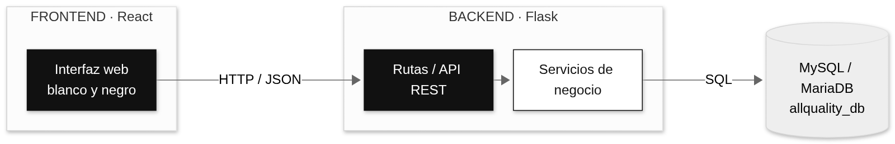
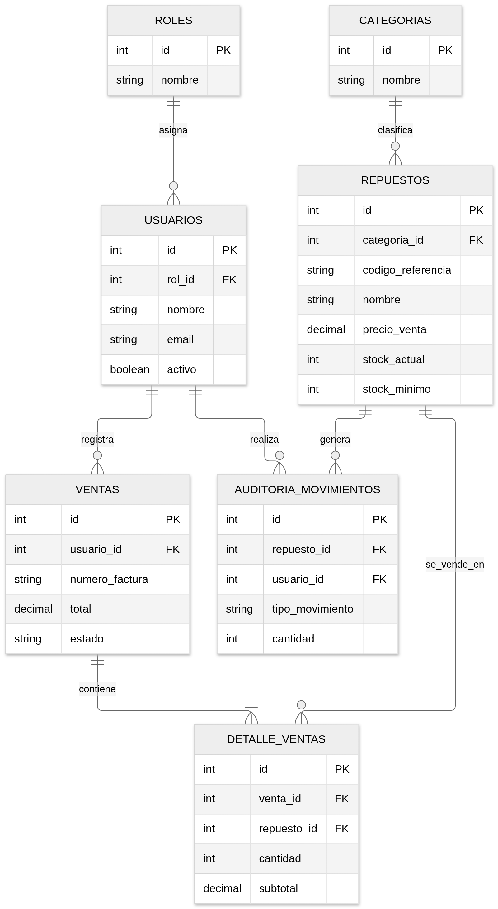
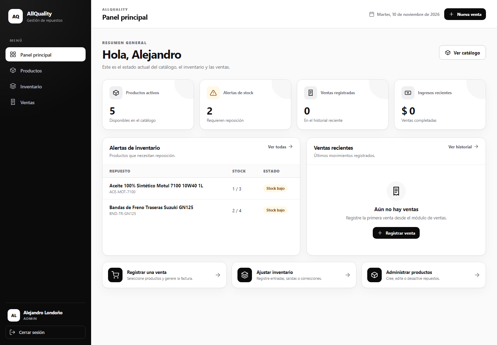
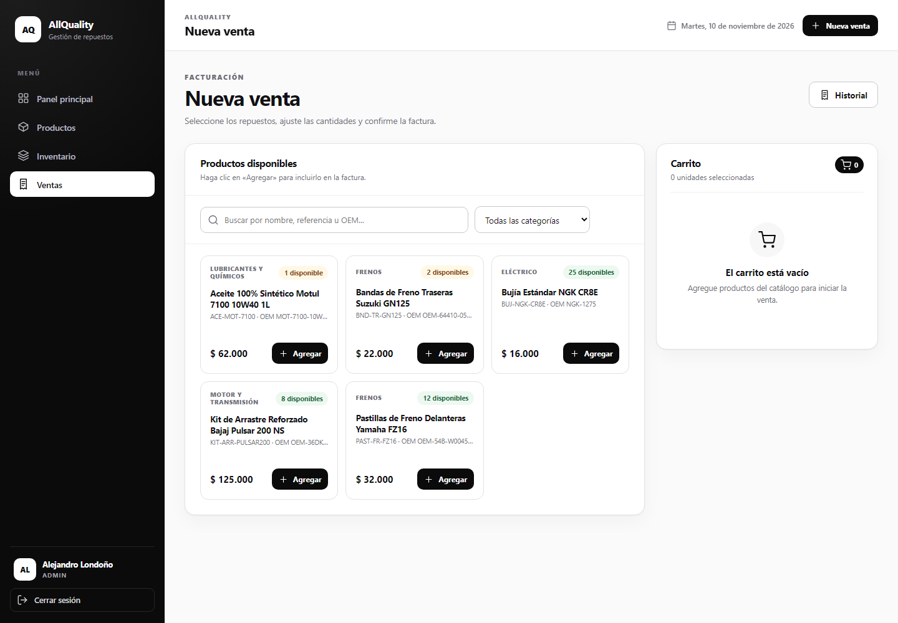
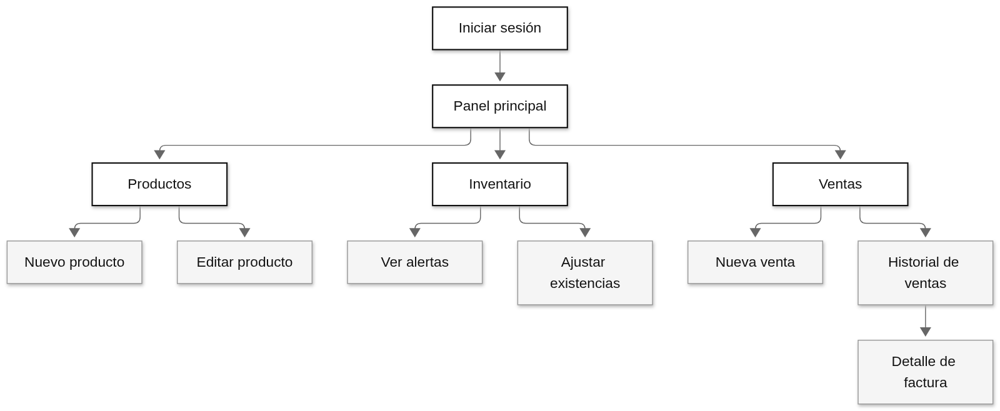
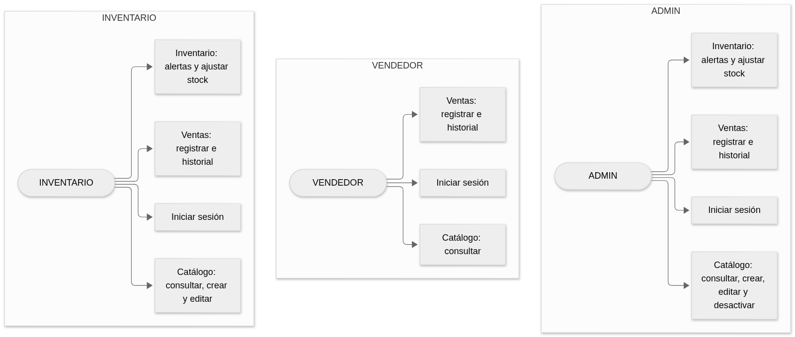
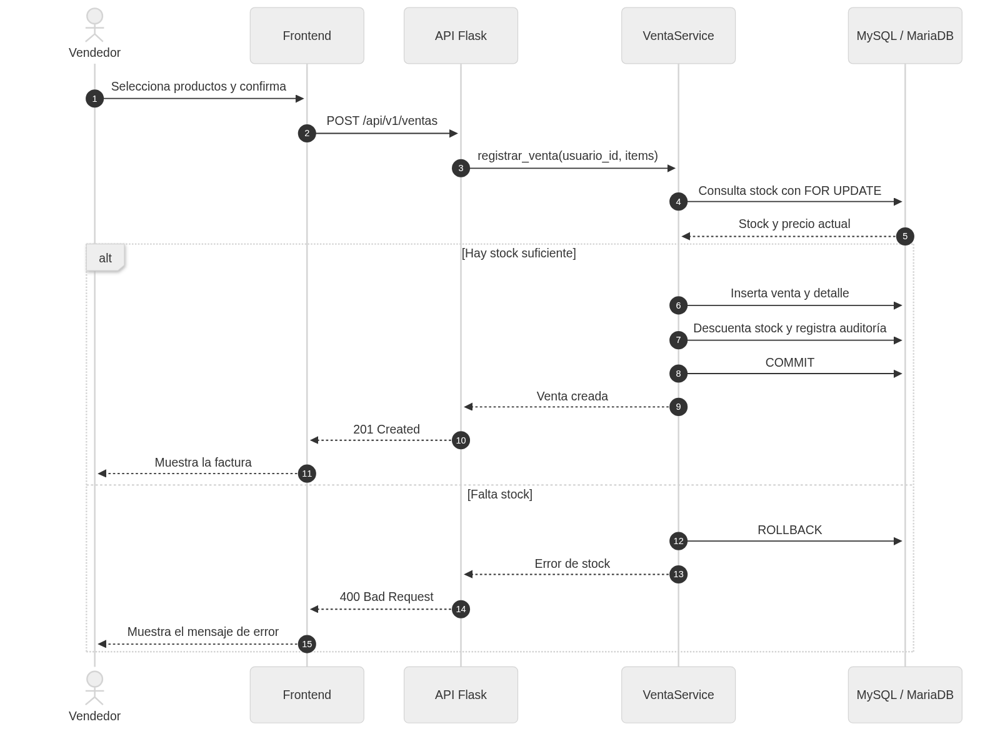
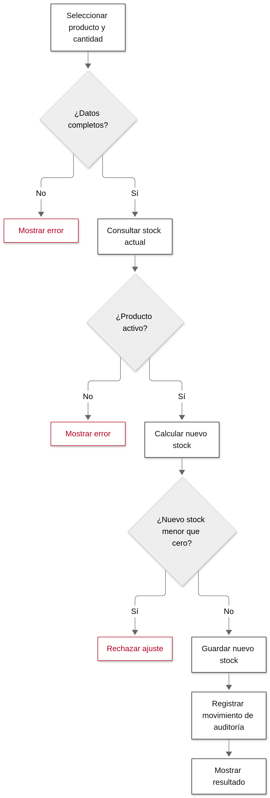
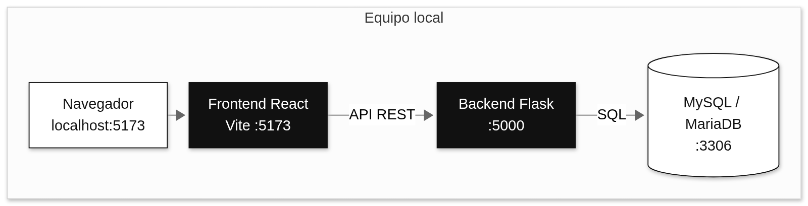

# AllQuality — Sistema de Gestión Comercial de Repuestos para Motocicletas

**Corporación de Estudios Tecnológicos del Norte del Valle (COTECNOVA)**  
**Ingeniería de Software II — Periodo Académico 2026-2**  
**Docente:** Felipe Gutiérrez Isaza

**Repositorio:** <https://github.com/jarlonpayp-sudo/TALLER-FINAL>  
**Tablero Trello:** [Proyecto Final AllQuality](https://trello.com/invite/b/6ae20964673dd65bcfef559f/ATTI90fd9b632977854e57ae366056873e0d6B0BC26B/proyecto-final)  
**Última actualización:** 10 de noviembre de 2026

---

## Documentación del proyecto

| Documento | Contenido |
| :--- | :--- |
| [Especificación de requisitos](docs/especificacion.md) | Requisitos funcionales y no funcionales, priorización MoSCoW y criterios de aceptación BDD. |
| [Plan de pruebas](docs/plan-de-pruebas.md) | Técnicas EP/BVA, casos CP-01 a CP-13, matriz de trazabilidad y automatización con `pytest`. |
| [Verificación de requisitos](docs/verificacion-requisitos.md) | Matriz de cumplimiento RF/RNF, evidencia de pruebas y brechas pendientes. |
| [Informe de calidad](docs/informe-calidad.md) | Evaluación ISO/IEC 25010, bitácora DEF-01 a DEF-05 y acciones de mantenimiento ISO/IEC 14764. |
| [Diagramas](docs/diagramas.md) | Diagramas en imagen PNG y código Mermaid: modelo ER, arquitectura, navegación, roles, venta, inventario y despliegue. |
| [Modelo de datos](docs/modelo-datos.md) | Diccionario completo de las 7 tablas, relaciones, restricciones y consultas de negocio. |

---

## Tabla de contenido

1. [Descripción general](#1-descripción-general)
2. [Equipo y roles](#2-equipo-y-roles)
3. [Arquitectura del sistema](#3-arquitectura-del-sistema)
4. [Modelo de datos](#4-modelo-de-datos)
5. [API REST](#5-api-rest)
6. [Frontend React](#6-frontend-react)
7. [Seguridad](#7-seguridad)
8. [Pruebas automatizadas](#8-pruebas-automatizadas)
9. [Calidad y mantenimiento](#9-calidad-y-mantenimiento)
10. [Instalación y ejecución local](#10-instalación-y-ejecución-local)
11. [Estructura del repositorio](#11-estructura-del-repositorio)
12. [Diagramas](#12-diagramas)
13. [Flujo de trabajo](#13-flujo-de-trabajo)
14. [Mejoras previstas](#14-mejoras-previstas)

---

## 1. Descripción general

**AllQuality** es una aplicación web para administrar un establecimiento que comercializa repuestos, accesorios, lubricantes y consumibles para motocicletas. El sistema centraliza el catálogo, controla las existencias en tiempo real, alerta cuando un producto llega al stock mínimo, registra las ventas y deja trazabilidad de cada movimiento.

La solución está compuesta por una **API REST en Flask**, una base de datos **MySQL/InnoDB** y un **cliente web en React 18 + Vite**. El frontend usa una interfaz sencilla en blanco y negro, con navegación lateral, formularios modales, tablas responsivas y mensajes claros de éxito o error.

### 1.1. Funcionalidades principales

- Inicio de sesión con contraseñas almacenadas mediante `werkzeug.security` y token de sesión firmado.
- Roles `ADMIN`, `VENDEDOR` e `INVENTARIO`, validados tanto en la interfaz como en el backend.
- Administración de colaboradores por parte del `ADMIN`: alta, cambio de rol, suspensión y reactivación.
- Catálogo de repuestos con código interno, código OEM, categoría, marca de moto, precios y stock.
- Búsqueda por nombre, código de referencia o código OEM, y filtro por categoría.
- Creación, actualización y desactivación lógica de repuestos.
- Consulta de alertas cuando `stock_actual <= stock_minimo`.
- Ajuste manual de existencias con justificación y registro de auditoría.
- Registro de ventas con una o varias líneas, cálculo de subtotales y total.
- Descuento atómico de existencias con bloqueo `FOR UPDATE` y `rollback` ante errores.
- Historial de ventas y consulta del detalle de cada factura.
- Panel principal con indicadores de inventario, alertas y ventas recientes.

### 1.2. Experiencia de usuario

- Diseño **blanco y negro**, sin dependencias de librerías visuales externas.
- Menú lateral fijo en escritorio y menú desplegable en móvil.
- Tablas con acciones contextuales, modales de edición y confirmaciones.
- Carrito de venta con búsqueda, filtro por categoría, control de cantidades y validación de stock.
- Mensajes de error del backend mostrados directamente en la interfaz.
- Roles reflejados en la interfaz: `ADMIN` administra usuarios, catálogo e inventario; `INVENTARIO` administra catálogo e inventario; `VENDEDOR` consulta y registra ventas.

---

## 2. Equipo y roles

| Integrante | Rol en el proyecto | Responsabilidad principal |
| :--- | :--- | :--- |
| **Alejandro Londoño** | **Líder Técnico** | Coordina el alcance, la arquitectura, la integración de cambios y el modelo relacional en MySQL. |
| **Cristian Carabalí** | **Responsable de Pruebas (QA Lead)** | Diseña los casos de prueba bajo ISO/IEC/IEEE 29119, implementa la suite `pytest` y coordina la automatización. |
| **Steven Rendón** | **Responsable de Calidad** | Evalúa el cumplimiento de ISO/IEC 25010, conduce revisiones de código, registra defectos y propone mantenimiento. |
| **Santiago Calvo** | **Responsable de Documentación** | Mantiene el `README.md`, los documentos de `docs/`, los diagramas y la evidencia del proyecto. |

> **Compromiso del equipo:** todos los integrantes conocen la totalidad del código y de las decisiones técnicas, y están en capacidad de explicarlas individualmente durante la sustentación.

### 2.1. Trazabilidad de participación

La distribución de tareas y su evidencia se gestiona en Trello. Cada tarjeta incluye:

- Integrante asignado.
- Fecha de vencimiento.
- Descripción breve del resultado esperado.
- Enlace al commit o al archivo que resuelve la tarea.

El docente debe estar invitado al tablero. El enlace está en la parte superior de este README.

---

## 3. Arquitectura del sistema

### 3.1. Vista general



La imagen se genera desde el código Mermaid documentado en [Diagramas — Arquitectura](docs/diagramas.md#arquitectura). La suite actual suma **49 pruebas** automatizadas.

### 3.2. Capas

| Capa | Archivos | Responsabilidad |
| :--- | :--- | :--- |
| Interfaz | `src/frontend/src/` | Componentes React, páginas, contexto de autenticación y cliente HTTP. |
| Rutas / controladores | `src/backend/routes/` | Reciben HTTP, validan parámetros básicos y devuelven JSON. |
| Servicios de dominio | `src/backend/services/` | Reglas de negocio: catálogo, categorías, stock, ventas y auditoría. |
| Persistencia | `src/backend/database/connection.py` | Conexión a MySQL mediante PyMySQL con `DictCursor` y `utf8mb4`. |
| Configuración | `src/backend/config.py` | Variables de entorno para base de datos y servidor. |
| Aplicación | `src/backend/app.py` | Factoría `create_app`, CORS, blueprints y health check. |

### 3.3. Stack tecnológico

| Componente | Tecnología | Versión / detalle |
| :--- | :--- | :--- |
| Lenguaje backend | Python | 3.11+ (probado en 3.11.9) |
| Framework API | Flask | 3.0.3 |
| Sesiones | itsdangerous | Token firmado, vigencia de 8 horas |
| Hash de contraseñas | Werkzeug | `pbkdf2:sha256` |
| CORS | Flask-Cors | 4.0.1 |
| Conector MySQL | PyMySQL | 1.1.1 |
| Base de datos | MySQL / MariaDB | 8.0+ / InnoDB |
| Pruebas | pytest + pytest-cov | 8.2.2 / 5.0.0 |
| Frontend | React + React Router | 18.3.1 / 7.18.5 |
| Build frontend | Vite | 5.4.x |
| Despliegue | Local nativo | Sin Docker |

---

## 4. Modelo de datos

La base de datos `allquality_db` está compuesta por **7 tablas** en MySQL/InnoDB. El diagrama simplificado está en [Diagramas — Base de datos](docs/diagramas.md#base-datos) y el diccionario detallado en [Modelo de datos](docs/modelo-datos.md).



| Tabla | Propósito |
| :--- | :--- |
| `roles` | Catálogo de roles del sistema: ADMIN, VENDEDOR e INVENTARIO. |
| `usuarios` | Cuentas de acceso, rol asignado, estado y contraseña. |
| `categorias` | Clasificación de repuestos por familia comercial. |
| `repuestos` | Catálogo central: códigos, precios, stock actual y stock mínimo. |
| `ventas` | Cabecera de cada factura: usuario, número, subtotal, IVA, total y estado. |
| `detalle_ventas` | Líneas de la factura: repuesto, cantidad, precio histórico y subtotal. |
| `auditoria_movimientos` | Kardex de entradas y salidas: la Entrega 2 registra ventas y ajustes; el esquema admite compra y anulación para la entrega final. |

### 4.1. Reglas de integridad principales

- `repuestos.codigo_referencia` es único.
- `usuarios.email` es único.
- `ventas.numero_factura` es único.
- `precio_venta > 0`, `stock_actual >= 0`, `stock_minimo >= 0` y `cantidad > 0` mediante `CHECK`.
- Las llaves foráneas protegen la relación entre ventas, repuestos, usuarios y auditoría.
- `detalle_ventas.venta_id` usa `ON DELETE CASCADE`; el resto de relaciones no elimina historial.
- Las ventas descuentan stock dentro de una transacción; si falla una línea, se revierte toda la operación.

### 4.2. Datos semilla

El script `schema.sql` crea la base, las tablas y datos de demostración:

- 3 roles: `ADMIN`, `VENDEDOR`, `INVENTARIO`.
- 3 usuarios de ejemplo: `admin@allquality.com`, `vendedor@allquality.com` y `bodega@allquality.com`.
- 5 categorías: Frenos, Motor y Transmisión, Eléctrico, Lubricantes y Químicos, Accesorios.
- 5 repuestos de ejemplo, incluidos dos casos de alerta de stock.

> Los usuarios y datos semilla son de demostración. No deben usarse como credenciales reales en producción.

---

## 5. API REST

**URL base local:** `http://127.0.0.1:5000/api/v1`  
**Formato:** JSON (`application/json`)  
**CORS:** habilitado para `/api/*`.

Todos los endpoints de negocio requieren un token de sesión válido enviado en la cabecera `Authorization: Bearer <token>`. El login y el health check son públicos. La columna «Rol permitido» indica la restricción que aplica el backend.

### 5.1. Endpoints

| Método | Endpoint | Descripción | Rol permitido |
| :---: | :--- | :--- | :--- |
| `GET` | `/health` | Estado del servicio y motor de base de datos. | Público |
| `POST` | `/auth/login` | Inicio de sesión; devuelve datos del usuario y token firmado. | Público |
| `GET` | `/categorias` | Lista las categorías disponibles para el catálogo. | Cualquier sesión |
| `GET` | `/productos` | Lista repuestos activos. Acepta `?q=` y `?cat=`. | Cualquier sesión |
| `GET` | `/productos/{id}` | Consulta un repuesto por ID. | Cualquier sesión |
| `POST` | `/productos` | Registra un repuesto con validación de código único. | ADMIN / INVENTARIO |
| `PUT` | `/productos/{id}` | Actualiza nombre, categoría, códigos, precios y stock mínimo. | ADMIN / INVENTARIO |
| `DELETE` | `/productos/{id}` | Desactiva lógicamente un repuesto (`activo = 0`). | ADMIN / INVENTARIO |
| `GET` | `/inventario/alertas` | Lista repuestos con `stock_actual <= stock_minimo`. | Cualquier sesión |
| `POST` | `/inventario/ajuste` | Ajusta existencias y registra auditoría. | ADMIN / INVENTARIO |
| `GET` | `/ventas` | Lista las ventas recientes. Acepta `?limit=`. | Cualquier sesión |
| `GET` | `/ventas/{id}` | Consulta una venta con su detalle. | Cualquier sesión |
| `POST` | `/ventas` | Registra una venta y descuenta stock de forma atómica. | ADMIN / VENDEDOR / INVENTARIO |
| `GET` | `/usuarios` | Lista colaboradores y roles disponibles. | ADMIN |
| `POST` | `/usuarios` | Crea un colaborador con contraseña inicial y rol. | ADMIN |
| `PUT` | `/usuarios/{id}` | Actualiza datos, rol, contraseña o estado del colaborador. | ADMIN |
| `DELETE` | `/usuarios/{id}` | Suspende lógicamente el acceso del colaborador. | ADMIN |

> **Nota de seguridad:** las contraseñas se almacenan con hash `pbkdf2:sha256` y el token está firmado con `SECRET_KEY` (vigencia de 8 horas). El backend valida el token y el rol antes de ejecutar cada operación. Para producción aún se recomienda cambiar `SECRET_KEY`, usar HTTPS, restringir CORS y obtener el usuario desde el token en lugar del cuerpo de la venta.

### 5.2. Ejemplos de uso

#### Iniciar sesión

```http
POST /api/v1/auth/login
Content-Type: application/json

{
  "email": "vendedor@allquality.com",
  "password": "Admin123*"
}
```

```json
{
  "mensaje": "Inicio de sesión exitoso",
  "usuario": {
    "id": 2,
    "nombre": "Cristian Carabalí",
    "email": "vendedor@allquality.com",
    "rol": "VENDEDOR"
  },
  "token": "<token-firmado-de-sesión>"
}
```

Las peticiones siguientes deben incluir:

```http
Authorization: Bearer <token-firmado-de-sesión>
```

#### Listar y buscar repuestos

```http
GET /api/v1/productos?q=Yamaha&cat=1
```

```json
{
  "total": 1,
  "productos": [
    {
      "id": 1,
      "categoria_id": 1,
      "codigo_referencia": "PAST-FR-FZ16",
      "codigo_oem": "OEM-54B-W0045-00",
      "nombre": "Pastillas de Freno Delanteras Yamaha FZ16",
      "marca_moto": "Yamaha FZ16 / FZ 2.0",
      "precio_compra": 18000.0,
      "precio_venta": 32000.0,
      "stock_actual": 12,
      "stock_minimo": 3,
      "activo": 1,
      "categoria_nombre": "Frenos"
    }
  ]
}
```

#### Actualizar un repuesto

```http
PUT /api/v1/productos/1
Content-Type: application/json

{
  "categoria_id": 1,
  "codigo_referencia": "PAST-FR-FZ16",
  "codigo_oem": "OEM-54B-W0045-00",
  "nombre": "Pastillas de Freno Delanteras Yamaha FZ16",
  "marca_moto": "Yamaha FZ16 / FZ 2.0",
  "precio_compra": 18000.0,
  "precio_venta": 34000.0,
  "stock_minimo": 4
}
```

La actualización no modifica el stock actual; ese valor se controla desde los ajustes de inventario y las ventas.

#### Consultar alertas

```http
GET /api/v1/inventario/alertas
```

```json
{
  "total_alertas": 2,
  "productos_en_alerta": [
    {
      "id": 2,
      "codigo_referencia": "BND-TR-GN125",
      "nombre": "Bandas de Freno Traseras Suzuki GN125",
      "stock_actual": 2,
      "stock_minimo": 4,
      "categoria_nombre": "Frenos",
      "nivel_alerta": "STOCK_BAJO"
    }
  ]
}
```

#### Ajustar existencias

```http
POST /api/v1/inventario/ajuste
Content-Type: application/json

{
  "repuesto_id": 1,
  "cantidad": 5,
  "tipo": "AJUSTE",
  "usuario_id": 1,
  "justificacion": "Recepción manual de mercancía"
}
```

```json
{
  "mensaje": "Inventario ajustado correctamente.",
  "resultado": {
    "repuesto_id": 1,
    "stock_anterior": 12,
    "stock_nuevo": 17,
    "cambio": 5
  }
}
```

#### Registrar una venta

```http
POST /api/v1/ventas
Content-Type: application/json

{
  "usuario_id": 2,
  "notas": "Venta de mostrador",
  "items": [
    { "repuesto_id": 3, "cantidad": 2 },
    { "repuesto_id": 4, "cantidad": 1 }
  ]
}
```

```json
{
  "mensaje": "Venta registrada e inventario actualizado exitosamente.",
  "venta": {
    "venta_id": 1,
    "numero_factura": "FAC-1762812345-321",
    "total": 266000.0,
    "items_vendidos": 2,
    "detalles": [
      {
        "repuesto_id": 3,
        "nombre": "Kit de Arrastre Reforzado Bajaj Pulsar 200 NS",
        "cantidad": 2,
        "precio_unitario": 125000.0,
        "subtotal": 250000.0,
        "stock_anterior": 8,
        "stock_nuevo": 6
      },
      {
        "repuesto_id": 4,
        "nombre": "Bujía Estándar NGK CR8E",
        "cantidad": 1,
        "precio_unitario": 16000.0,
        "subtotal": 16000.0,
        "stock_anterior": 25,
        "stock_nuevo": 24
      }
    ]
  }
}
```

#### Consultar el historial de ventas

```http
GET /api/v1/ventas?limit=10
```

```json
{
  "total": 1,
  "ventas": [
    {
      "id": 1,
      "numero_factura": "FAC-1762812345-321",
      "subtotal": 266000.0,
      "iva": 0.0,
      "total": 266000.0,
      "estado": "COMPLETADA",
      "notas": "Venta de mostrador",
      "created_at": "2026-11-10T15:04:00",
      "vendedor_nombre": "Cristian Carabalí"
    }
  ]
}
```

### 5.3. Formato de error

Todos los errores controlados devuelven un objeto JSON con la clave `error`:

```json
{
  "error": "Stock insuficiente para 'Kit de Arrastre Reforzado Bajaj Pulsar 200 NS': quedan 6 unidades y solicitó 10."
}
```

| Código | Significado |
| :---: | :--- |
| `200` | Operación exitosa. |
| `201` | Recurso creado. |
| `400` | Datos inválidos, stock insuficiente o carrito vacío. |
| `401` | Credenciales inválidas. |
| `403` | Cuenta inactiva. |
| `404` | Recurso no encontrado. |
| `409` | Código de referencia duplicado. |
| `422` | Error de validación de precio, stock o campos obligatorios. |
| `500` | Error interno no controlado. |

---

## 6. Frontend React

### 6.1. Páginas

| Ruta | Página | Funcionalidad |
| :--- | :--- | :--- |
| `/login` | Inicio de sesión | Autenticación, persistencia de sesión y acceso según rol. |
| `/` | Panel principal | Indicadores de catálogo, alertas, ventas y acciones rápidas. |
| `/productos` | Productos | Búsqueda, filtro por categoría, creación, edición y desactivación. |
| `/inventario` | Inventario | Alertas de stock y formulario de ajuste con justificación. |
| `/ventas` | Ventas | Historial de facturas y consulta del detalle. |
| `/ventas/nueva` | Nueva venta | Catálogo filtrable, carrito, control de cantidades y confirmación. |
| `/usuarios` | Usuarios | Alta, edición de rol, suspensión y reactivación de colaboradores (solo `ADMIN`). |

### 6.2. Comportamiento por rol

| Rol | Productos | Inventario | Ventas | Usuarios |
| :--- | :--- | :--- | :--- | :--- |
| `ADMIN` | Ver, crear, editar y desactivar. | Ver y ajustar. | Ver historial y registrar ventas. | Crear, editar, suspender y reactivar. |
| `INVENTARIO` | Ver, crear, editar y desactivar. | Ver y ajustar. | Ver historial y registrar ventas. | Sin acceso. |
| `VENDEDOR` | Consultar catálogo. | Consultar alertas sin modificar. | Ver historial y registrar ventas. | Sin acceso. |

### 6.3. Ejecución en desarrollo

```powershell
cd src/frontend
npm install
npm run dev
```

Abrir <http://localhost:5173>. Vite redirige las peticiones `/api` al backend en `http://127.0.0.1:5000`.

Si el backend se ejecuta en otra URL, crear `src/frontend/.env.local` a partir de `.env.example`:

```env
VITE_API_URL=http://127.0.0.1:5000/api/v1
```

### 6.4. Compilación de producción

```powershell
cd src/frontend
npm run build
```

El resultado queda en `src/frontend/dist/`. Para servirlo localmente con el proxy de Vite:

```powershell
npm run preview
```

La compilación de producción se verificó con `vite build` sin errores.

### 6.5. Vista previa

| Panel principal | Nueva venta |
| :---: | :---: |
|  |  |

---

## 7. Seguridad

### 7.1. Medidas actuales

- Login mediante `POST /api/v1/auth/login` con correo y contraseña.
- Contraseñas almacenadas con hash `pbkdf2:sha256` mediante `werkzeug.security`; no se guardan en texto plano.
- Token de sesión firmado con `itsdangerous` y `SECRET_KEY`, con vigencia de 8 horas (`TOKEN_MAX_AGE`).
- Decoradores `@require_auth` y `@require_role(...)` aplicados a los endpoints de negocio.
- El rol `VENDEDOR` no puede crear productos, ajustar inventario ni administrar usuarios; el rol `INVENTARIO` no puede administrar usuarios.
- El backend impide que un administrador suspenda su propia cuenta.
- CORS habilitado para `/api/*` en el entorno local.
- El archivo `.gitignore` excluye `.env`, credenciales y archivos temporales.
- La interfaz oculta rutas y acciones administrativas a los roles no autorizados, y redirige al panel si se intenta abrir `/usuarios` sin ser `ADMIN`.

### 7.2. Limitaciones y mejoras previstas

| Riesgo | Impacto | Acción prevista |
| :--- | :--- | :--- |
| `SECRET_KEY` por defecto en el repositorio | Si se publica, un tercero podría intentar firmar tokens. | Configurar una clave larga y secreta por entorno antes de desplegar. |
| `usuario_id` recibido en el cuerpo de la venta | Un cliente autenticado podría declarar otro vendedor. | Obtener el usuario desde el token y no desde el cuerpo. |
| CORS abierto (`*`) | Adecuado para desarrollo, no para producción. | Restringir orígenes en el despliegue. |
| HTTP local sin TLS | El token viaja sin cifrar en la red local. | Publicar detrás de HTTPS en producción. |
| Sin límite de intentos de login | Posible fuerza bruta. | Agregar rate limiting y bloqueo temporal. |
| Sin recuperación de contraseña | El administrador debe asignar una nueva. | Implementar flujo de restablecimiento seguro. |

> Estas acciones están registradas en el informe de calidad y forman parte del plan de mejora del producto.

---

## 8. Pruebas automatizadas

### 8.1. Cómo ejecutar la suite

Desde la raíz del repositorio:

```powershell
python -m pytest -q
```

Con cobertura:

```powershell
python -m pytest --cov=src/backend --cov-report=term-missing -q
```

### 8.2. Resultado actual

```text
49 passed
Cobertura total: 90%
```

| Archivo | Pruebas | Qué cubre |
| :--- | :---: | :--- |
| `tests/backend/test_auth.py` | 3 | Login exitoso, contraseña incorrecta y usuario inexistente. |
| `tests/backend/test_auth_roles.py` | 6 | Token ausente o inválido, lectura autorizada y rechazo de escrituras para `VENDEDOR`. |
| `tests/backend/test_productos.py` | 7 | Listado, búsqueda, creación, stock obligatorio, duplicados, precios límite y desactivación lógica. |
| `tests/backend/test_inventario_s1.py` | 5 | Alertas, ajuste de stock, bloqueo de saldo negativo, venta atómica y anti-sobreventa. |
| `tests/backend/test_api_extra.py` | 20 | Health, errores HTTP, categorías, actualización de producto, historial y detalle de ventas. |
| `tests/backend/test_usuarios.py` | 8 | Alta de colaboradores, roles, correo único, suspensión, revocación de sesión y restricción a `ADMIN`. |
| **Total** | **49** | Autenticación, permisos, catálogo, inventario, ventas y administración de usuarios. |

### 8.3. Cobertura por módulo

| Módulo | Cobertura |
| :--- | :---: |
| `app.py` | 84% |
| `auth_utils.py` | 92% |
| `config.py` | 100% |
| `database/connection.py` | 75% |
| `routes/auth_routes.py` | 100% |
| `routes/categoria_routes.py` | 100% |
| `routes/inventario_routes.py` | 93% |
| `routes/producto_routes.py` | 93% |
| `routes/usuario_routes.py` | 73% |
| `routes/venta_routes.py` | 89% |
| `services/categoria_service.py` | 100% |
| `services/inventario_service.py` | 100% |
| `services/producto_service.py` | 92% |
| `services/usuario_service.py` | 85% |
| `services/venta_service.py` | 99% |
| **Total** | **90%** |

### 8.4. Técnicas de diseño aplicadas

- **Partición de clases de equivalencia (EP):** precios, existencias, códigos y estados de stock.
- **Análisis de valores límite (BVA):** precio `0`, `-0.01`, `+0.01`; stock `0`, `1`, `-1`; umbral de stock mínimo.
- **Pruebas de integración de API:** peticiones HTTP con `Flask test_client` y validación de códigos de estado.
- **Pruebas de autorización:** tokens ausentes, inválidos y usuarios con rol insuficiente.
- **Matriz de trazabilidad:** requisito → caso de prueba → suite automatizada, ampliada en [Verificación de requisitos](docs/verificacion-requisitos.md).
- **Verificación de interfaz:** flujos de login, catálogo, inventario, ventas y usuarios ejecutados con Playwright y Chrome.

> **Limitación importante:** la suite automatizada usa una conexión MySQL simulada (`FakeMySQLConnection`) para ser rápida y determinista. La aplicación se validó manualmente contra **MariaDB 10.4.32 de XAMPP**, incluida una venta real, el descuento de stock, el rollback multiítem, la auditoría y la administración de usuarios. La integración automatizada contra MySQL/MariaDB real y las pruebas de concurrencia quedan como mejora prevista.

---

## 9. Calidad y mantenimiento

### 9.1. Evaluación ISO/IEC 25010

| Característica | Evaluación | Evidencia |
| :--- | :--- | :--- |
| Adecuación funcional | Catálogo, inventario, ventas, autenticación y administración de usuarios implementados. | 49 pruebas aprobadas y matriz RF/RNF. |
| Eficiencia de desempeño | Respuestas locales rápidas; no se ejecutó benchmark con 1.000 repuestos. | Pruebas locales y verificación manual. |
| Compatibilidad | Frontend React, API JSON y MariaDB/MySQL. | Integración manual verificada en XAMPP. |
| Capacidad de interacción | Códigos HTTP, mensajes de error y formularios claros. | Rutas, servicios e interfaz. |
| Fiabilidad | Venta atómica con `FOR UPDATE` y `rollback`. | `venta_service.py` y prueba multiítem. |
| Seguridad | Hash de contraseñas, token firmado y roles validados en backend. | Sección 7 y pruebas de autorización. |
| Mantenibilidad | Arquitectura por capas, componentes reutilizables y documentación técnica. | `src/`, `docs/`. |
| Portabilidad | Ejecución local nativa sin Docker. | Guía de instalación. |

### 9.2. Bitácora de defectos

| ID | Defecto | Severidad | Corrección aplicada | Prueba asociada |
| :---: | :--- | :---: | :--- | :--- |
| **DEF-01** | Aceptación de precios cero o negativos al crear repuesto. | Alta | Validación `precio_venta > 0` con HTTP 422. | `test_rechazo_precio_limite_invalido_bva` |
| **DEF-02** | Colisión de códigos de referencia duplicados. | Alta | Verificación de unicidad con HTTP 409. | `test_rechazo_codigo_duplicado` |
| **DEF-03** | Posibilidad de saldo negativo en ajustes manuales. | Crítica | Guardia anti-sobreventa con HTTP 400. | `test_bloqueo_ajuste_stock_negativo` |
| **DEF-04** | Venta no atómica con múltiples productos. | Crítica | Transacción con `rollback` y validación previa. | `test_bloqueo_sobreventa_stock_insuficiente` |
| **DEF-05** | Token sin firma y roles validados solo en la interfaz. | Crítica | Token firmado, contraseñas con hash y decoradores de rol en el backend. | `test_endpoint_protegido_sin_token`, `test_vendedor_no_puede_crear_productos` |

### 9.3. Acciones de mantenimiento (ISO/IEC 14764)

- **Correctivo:** validación de límites numéricos, códigos duplicados y stock negativo.
- **Preventivo:** estandarización de tipos, exclusión de archivos temporales y separación de configuración.
- **Perfectivo:** desacoplamiento en rutas, servicios y capa de conexión; incorporación del cliente React, administración de usuarios, endurecimiento de autenticación y documentación con diagramas en imagen.

> El detalle completo está en [`docs/informe-calidad.md`](docs/informe-calidad.md).

---

## 10. Instalación y ejecución local

### 10.1. Requisitos previos

- **Python 3.11+** (probado con Python 3.11.9).
- **MySQL 8.0+ / MariaDB** activo en `127.0.0.1:3306` (XAMPP, Laragon o instalación nativa).
- **Node.js 20+** y npm para el frontend.

### 10.2. Paso 1: crear la base de datos

Desde la raíz del repositorio, con el cliente de MySQL disponible en el `PATH`:

```powershell
mysql -u root -p --default-character-set=utf8mb4 -e "source C:/ruta/completa/al/proyecto/src/backend/database/schema.sql"
```

También se puede importar `src/backend/database/schema.sql` desde phpMyAdmin o MySQL Workbench. El script crea `allquality_db`, las 7 tablas y los datos semilla.

> En Windows, usar rutas con barras inclinadas (`/`) dentro del comando `source`. Esto evita problemas de codificación con acentos.

### 10.3. Paso 2: configurar el backend

```powershell
cd src/backend

# Crear y activar entorno virtual
python -m venv venv
.\venv\Scripts\Activate.ps1

# Instalar dependencias
python -m pip install -r requirements.txt
```

Variables de entorno opcionales (tienen valores por defecto para desarrollo local):

```powershell
$env:DB_HOST = "127.0.0.1"
$env:DB_PORT = "3306"
$env:DB_USER = "root"
$env:DB_PASSWORD = ""
$env:DB_NAME = "allquality_db"
$env:SECRET_KEY = "cambiar-en-produccion"
$env:PORT = "5000"
```

### 10.4. Paso 3: iniciar el backend

```powershell
python app.py
```

Verificar el servicio:

```powershell
Invoke-RestMethod http://127.0.0.1:5000/api/v1/health
```

Respuesta esperada:

```json
{
  "status": "online",
  "sistema": "AllQuality - Gestión Comercial de Repuestos para Motocicletas",
  "version": "1.0.0",
  "motor_bd": "MySQL (InnoDB)"
}
```

### 10.5. Paso 4: iniciar el frontend

En otra terminal:

```powershell
cd src/frontend
npm install
npm run dev
```

Abrir <http://localhost:5173>.

### 10.6. Credenciales de demostración

| Rol | Correo | Contraseña |
| :--- | :--- | :--- |
| ADMIN | `admin@allquality.com` | `Admin123*` |
| VENDEDOR | `vendedor@allquality.com` | `Admin123*` |
| INVENTARIO | `bodega@allquality.com` | `Admin123*` |

### 10.7. Solución de problemas frecuentes

| Síntoma | Causa probable | Solución |
| :--- | :--- | :--- |
| `ModuleNotFoundError: No module named 'pymysql'` | Dependencias no instaladas. | `python -m pip install -r requirements.txt` |
| `ConnectionError: Error conectando al servidor MySQL` | MySQL apagado, base inexistente o credenciales incorrectas. | Iniciar MySQL, ejecutar `schema.sql` y revisar variables de entorno. |
| `Address already in use` en el puerto 5000 | Otro proceso usa el puerto. | `$env:PORT = "5001"` y volver a iniciar; ajustar `VITE_API_URL`. |
| El frontend muestra «No se pudo conectar con el servidor» | Backend apagado o URL incorrecta. | Iniciar el backend y verificar el proxy de Vite. |
| El navegador bloquea la petición | CORS no configurado. | Verificar `Flask-Cors` y el origen permitido. |
| Los acentos se ven como `?` | Codificación incorrecta al importar el SQL. | Reimportar con `--default-character-set=utf8mb4`. |

---

## 11. Estructura del repositorio

```text
TALLER-FINAL-main/
├── README.md
├── .gitignore
├── docs/
│   ├── especificacion.md
│   ├── plan-de-pruebas.md
│   ├── verificacion-requisitos.md
│   ├── informe-calidad.md
│   ├── diagramas.md
│   ├── modelo-datos.md
│   ├── diagramas/
│   │   ├── 01-base-datos.png
│   │   ├── 02-arquitectura.png
│   │   ├── 03-navegacion.png
│   │   ├── 04-casos-uso.png
│   │   ├── 05-venta.png
│   │   ├── 06-inventario.png
│   │   └── 07-despliegue.png
│   └── capturas/
│       ├── panel-principal.png
│       └── nueva-venta.png
├── src/
│   ├── backend/
│   │   ├── app.py
│   │   ├── auth_utils.py
│   │   ├── config.py
│   │   ├── requirements.txt
│   │   ├── database/
│   │   │   ├── connection.py
│   │   │   └── schema.sql
│   │   ├── routes/
│   │   │   ├── auth_routes.py
│   │   │   ├── categoria_routes.py
│   │   │   ├── producto_routes.py
│   │   │   ├── inventario_routes.py
│   │   │   ├── usuario_routes.py
│   │   │   └── venta_routes.py
│   │   └── services/
│   │       ├── categoria_service.py
│   │       ├── producto_service.py
│   │       ├── inventario_service.py
│   │       ├── usuario_service.py
│   │       └── venta_service.py
│   └── frontend/
│       ├── index.html
│       ├── package.json
│       ├── vite.config.js
│       ├── .env.example
│       ├── public/
│       │   └── favicon.svg
│       └── src/
│           ├── main.jsx
│           ├── App.jsx
│           ├── api.js
│           ├── utils.js
│           ├── styles.css
│           ├── components/
│           ├── context/
│           └── pages/
└── tests/
    └── backend/
        ├── conftest.py
        ├── test_auth.py
        ├── test_productos.py
        ├── test_inventario_s1.py
        ├── test_api_extra.py
        ├── test_auth_roles.py
        └── test_usuarios.py
```

---

## 12. Diagramas

Los diagramas se entregan como **imágenes PNG** en [`docs/diagramas/`](docs/diagramas/) y también están documentados en [`docs/diagramas.md`](docs/diagramas.md), donde se conserva el código Mermaid dentro de bloques plegables para poder regenerarlos.

| Modelo de base de datos | Arquitectura general |
| :---: | :---: |
|  |  |

| Navegación del frontend | Roles y casos de uso |
| :---: | :---: |
|  |  |

| Secuencia de venta | Flujo de inventario | Despliegue local |
| :---: | :---: | :---: |
|  |  |  |

| Diagrama | Propósito | Enlace |
| :--- | :--- | :--- |
| Base de datos | Modelo entidad-relación de las 7 tablas, claves y relaciones. | [Ver](docs/diagramas.md#base-datos) |
| Arquitectura general | Frontend, API, servicios y persistencia. | [Ver](docs/diagramas.md#arquitectura) |
| Navegación del frontend | Rutas y pantallas del cliente React. | [Ver](docs/diagramas.md#navegacion) |
| Casos de uso por rol | Operaciones permitidas para cada rol. | [Ver](docs/diagramas.md#casos-uso) |
| Registro de una venta | Secuencia transaccional con validación de stock. | [Ver](docs/diagramas.md#venta) |
| Ajuste de inventario | Flujo de actualización y auditoría. | [Ver](docs/diagramas.md#inventario) |
| Despliegue local | Componentes y puertos en el equipo del evaluador. | [Ver](docs/diagramas.md#despliegue) |

---

## 13. Flujo de trabajo

### 13.1. Convención de commits

```text
feat(backend): agregar endpoint de consulta de venta
feat(frontend): implementar carrito de nueva venta
fix(ventas): corregir validación de stock negativo
test(inventario): ampliar pruebas de valores límite
docs: actualizar diagramas y modelo de datos
```

### 13.2. Flujo de Trello

1. Mover la tarjeta de **Por hacer** a **En curso** al iniciar.
2. Al terminar código y pruebas, moverla a **En revisión** y agregar el hash del commit.
3. Tras la revisión del líder técnico o del responsable de calidad, moverla a **Hecho**.
4. Mantener una etiqueta por etapa: `Planeación`, `Desarrollo`, `Revisión`, `Entrega final`.

### 13.3. Etiquetas de Git

```powershell
# Etiqueta de la entrega final
git tag -a entrega-final -m "Versión funcional de AllQuality"
git push origin entrega-final
```

---

## 14. Mejoras previstas

### Prioridad alta

1. Implementar el registro de compras/recepciones (RF-08) con actualización automática de stock.
2. Implementar la anulación de ventas con reintegro de stock (RF-10).
3. Incorporar al menos una prueba automatizada de integración contra MariaDB/MySQL real.
4. Configurar `SECRET_KEY`, HTTPS, CORS restringido y rate limiting para despliegue.
5. Implementar reportes comerciales (RF-16) y respaldo/restauración integrados (RF-14/RF-15).

### Prioridad media

6. Agregar pruebas de concurrencia para la última unidad de stock.
7. Obtener el usuario desde el token en lugar del cuerpo de la venta.
8. Normalizar la serialización de valores `DECIMAL` en las respuestas JSON.
9. Agregar paginación al listado de repuestos y ventas.
10. Revisar y actualizar el tablero de Trello con la evidencia de cada integrante.

### Prioridad baja

11. Documentar un manual de usuario y un manual de despliegue.
12. Preparar la presentación de sustentación con los diagramas y la demo funcional.

---

**AllQuality — Ingeniería de Software II — COTECNOVA 2026-2**
