# Diagramas del Sistema «AllQuality»

**Proyecto:** Sistema de Gestión Comercial de Repuestos para Motocicletas  
**Asignatura:** Ingeniería de Software II — COTECNOVA 2026-2  
**Responsable de documentación:** Santiago Calvo

> Las versiones principales están en **imágenes PNG** dentro de [`docs/diagramas/`](diagramas/). Cada sección conserva el código Mermaid en un bloque desplegable para que el diagrama pueda editarse y regenerarse. Las imágenes usan un tema neutro en blanco, negro y grises para mantener la misma línea visual del frontend.

## Índice

1. [Base de datos](#base-datos)
2. [Arquitectura general](#arquitectura)
3. [Navegación del frontend](#navegacion)
4. [Casos de uso por rol](#casos-uso)
5. [Registro de una venta](#venta)
6. [Ajuste de inventario](#inventario)
7. [Despliegue local](#despliegue)

---

## 1. Base de datos

Vista simplificada del modelo entidad-relación. Las cajas representan tablas, `PK` identifica la clave primaria y `FK` las llaves foráneas. El diccionario completo de campos está en [`modelo-datos.md`](modelo-datos.md).

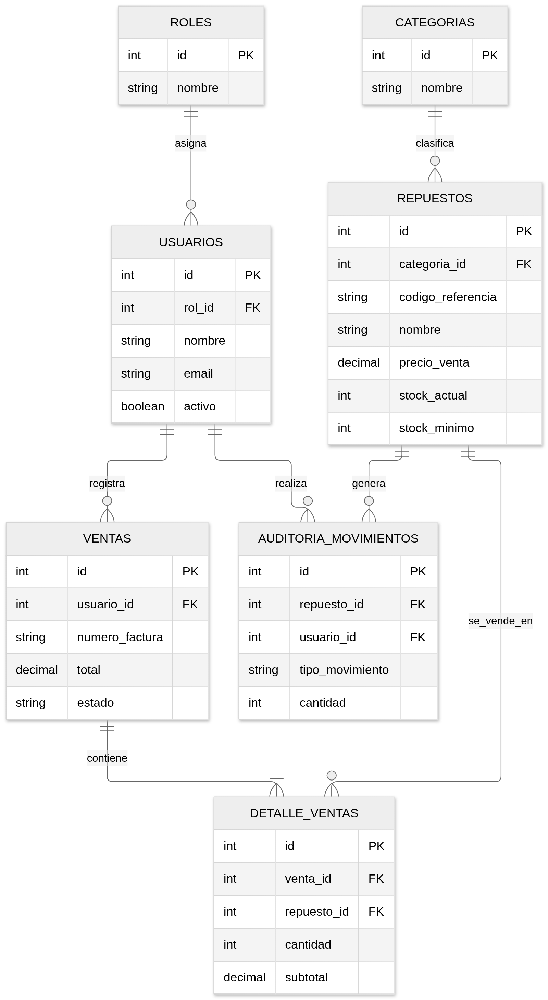

### Cómo leerlo

- Un **rol** puede tener muchos **usuarios**.
- Una **categoría** agrupa muchos **repuestos**.
- Un **usuario** registra muchas **ventas**.
- Una **venta** contiene varias líneas en **detalle_ventas**.
- Un **repuesto** puede aparecer en muchas ventas y en muchos movimientos de auditoría.
- `detalle_ventas` une ventas y repuestos; conserva la cantidad y el precio del momento de la venta.

### Relaciones principales

| Relación | Cardinalidad | Para qué sirve |
| :--- | :---: | :--- |
| `roles` → `usuarios` | 1:N | Define los permisos del usuario. |
| `categorias` → `repuestos` | 1:N | Organiza el catálogo. |
| `usuarios` → `ventas` | 1:N | Identifica quién vendió. |
| `ventas` → `detalle_ventas` | 1:N | Guarda los productos de la factura. |
| `repuestos` → `detalle_ventas` | 1:N | Relaciona cada línea con su producto. |
| `repuestos` → `auditoria_movimientos` | 1:N | Historial de entradas y salidas. |
| `usuarios` → `auditoria_movimientos` | 1:N | Identifica quién hizo el movimiento. |

Ver código Mermaid del diagrama

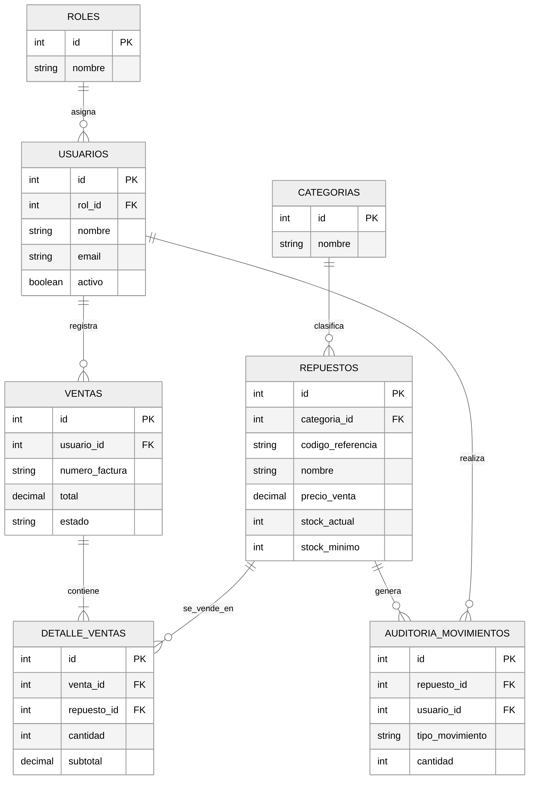

---

## 2. Arquitectura general

El frontend y el backend son dos aplicaciones separadas que se comunican por HTTP/JSON. La base de datos solo es accesible desde el backend.

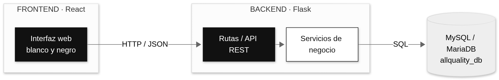

### Capas

| Capa | Tecnología | Responsabilidad |
| :--- | :--- | :--- |
| Interfaz | React + Vite | Login, catálogo, inventario y ventas. |
| API | Flask | Recibe peticiones, valida la sesión y devuelve JSON. |
| Negocio | Servicios Python | Valida precios, stock, ventas y auditoría. |
| Datos | MySQL / MariaDB InnoDB | Guarda usuarios, productos, ventas y movimientos. |

Ver código Mermaid del diagrama

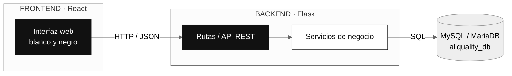

---

## 3. Navegación del frontend

Mapa de pantallas de la aplicación web.

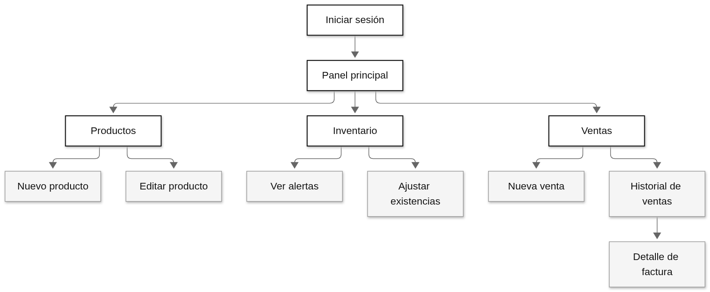

- **Panel principal:** resume productos, alertas y ventas recientes.
- **Productos:** buscar, crear, editar y desactivar repuestos.
- **Inventario:** consultar alertas y ajustar existencias.
- **Ventas:** registrar una venta o consultar el historial.

Ver código Mermaid del diagrama

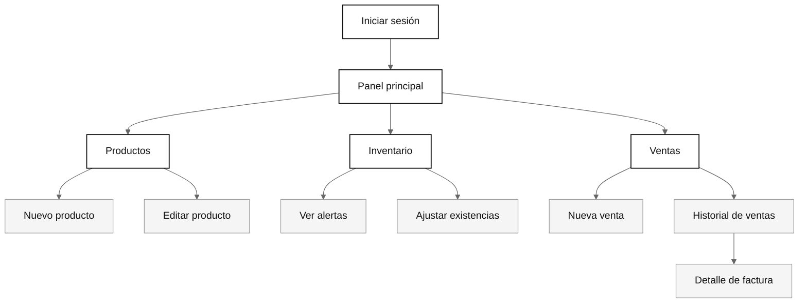

---

## 4. Casos de uso por rol

Vista rápida de qué puede hacer cada tipo de usuario.

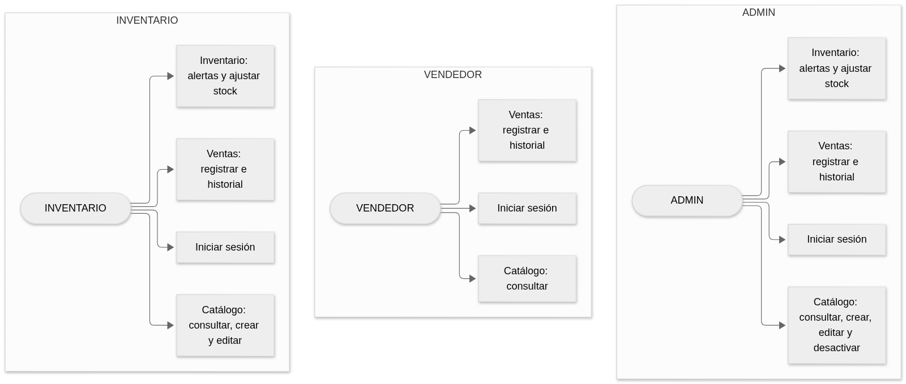

| Rol | Puede hacer |
| :--- | :--- |
| **ADMIN** | Todo: productos, inventario, ventas y consultas. |
| **VENDEDOR** | Consultar productos, registrar ventas y ver el historial. |
| **INVENTARIO** | Consultar productos, crear/editar repuestos, ver alertas, ajustar stock y registrar ventas. |

Ver código Mermaid del diagrama

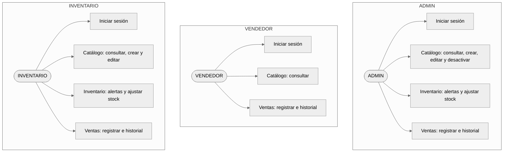

---

## 5. Registro de una venta

Flujo principal del sistema. Si un producto no tiene stock, la venta completa se cancela.

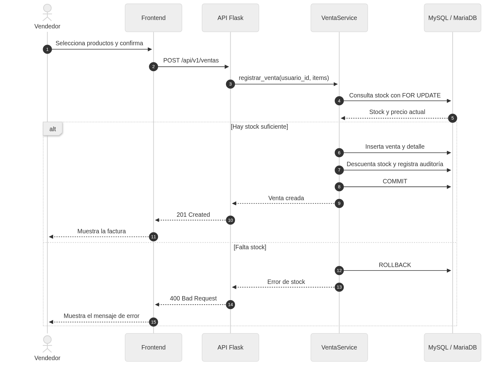

### Reglas importantes

- El stock se bloquea con `FOR UPDATE` mientras dura la venta.
- Si un solo producto falla, se revierte toda la operación.
- Cada producto vendido genera un movimiento de auditoría.
- El precio se guarda en la línea de la factura para conservar el historial.

Ver código Mermaid del diagrama

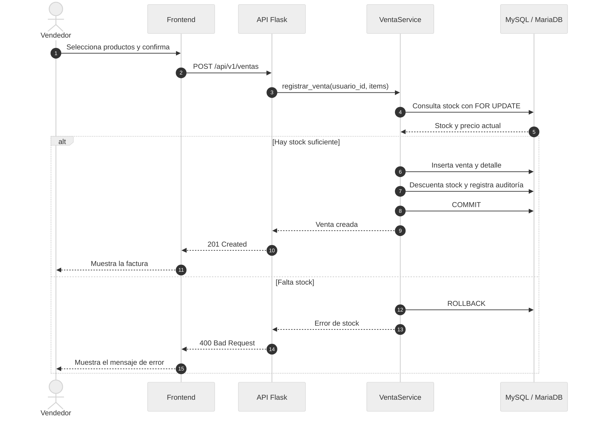

---

## 6. Ajuste de inventario

Flujo para sumar o restar existencias manualmente.

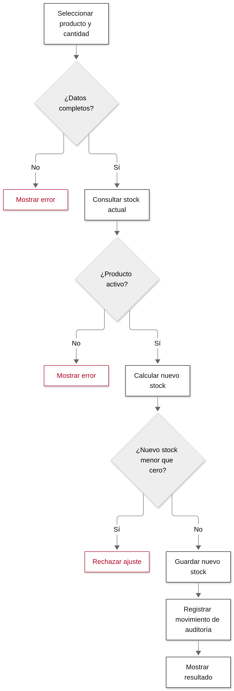

- La cantidad puede ser positiva (entrada) o negativa (salida).
- El sistema nunca permite dejar el stock en negativo.
- Todo ajuste queda registrado con usuario, fecha y justificación.

Ver código Mermaid del diagrama

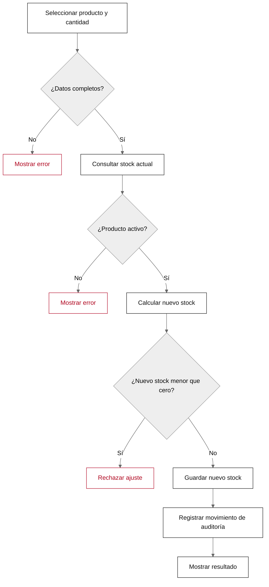

---

## 7. Despliegue local

La aplicación se ejecuta en el equipo del estudiante o evaluador, sin Docker.

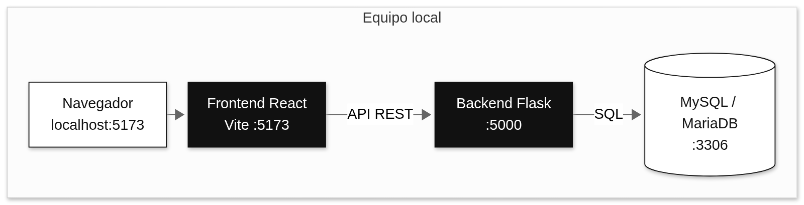

| Componente | Puerto | Comando |
| :--- | :---: | :--- |
| Frontend | `5173` | `cd src/frontend && npm run dev` |
| Backend | `5000` | `cd src/backend && python app.py` |
| MySQL / MariaDB | `3306` | Iniciar MySQL desde XAMPP o Laragon. |

Ver código Mermaid del diagrama

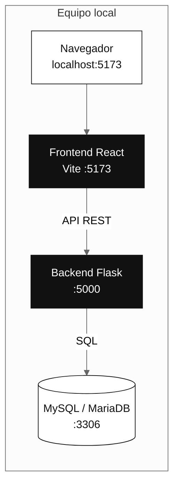

---

**AllQuality — Ingeniería de Software II — COTECNOVA 2026-2**
